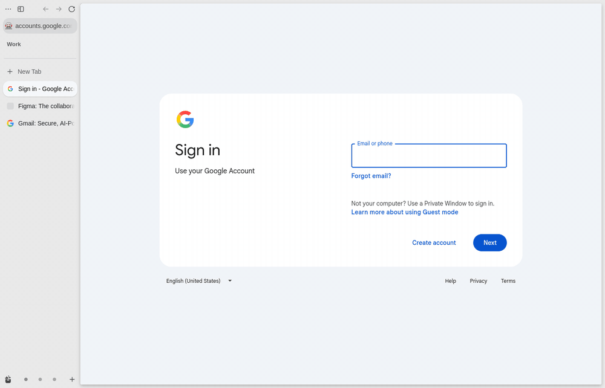
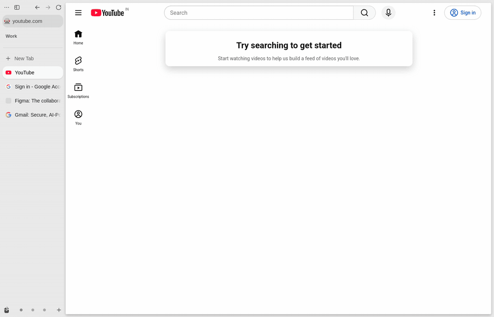
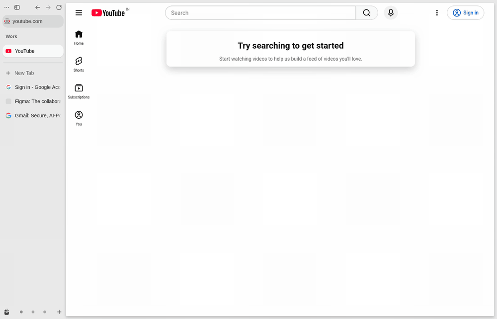
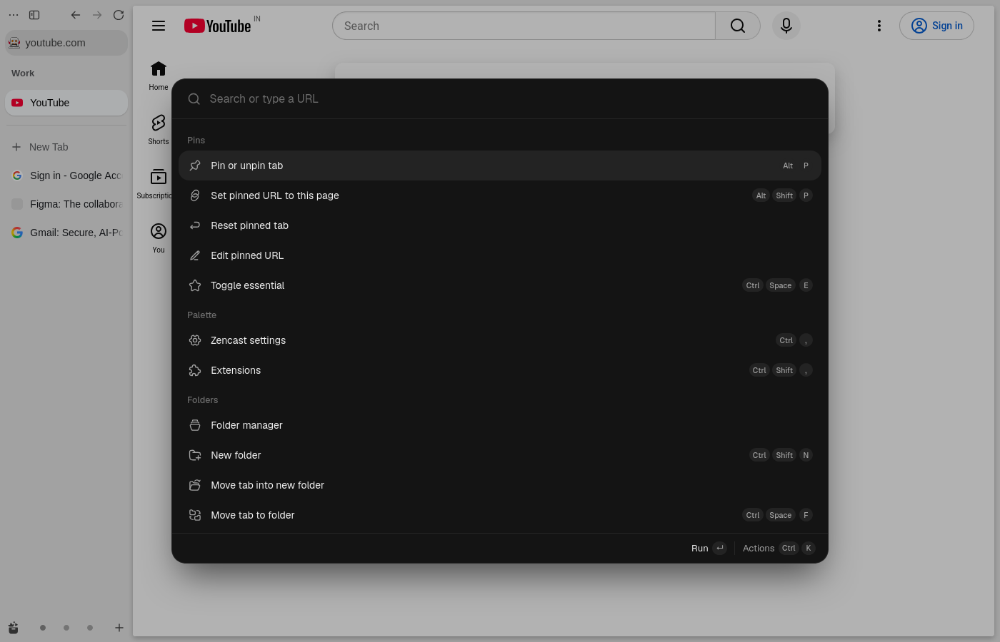
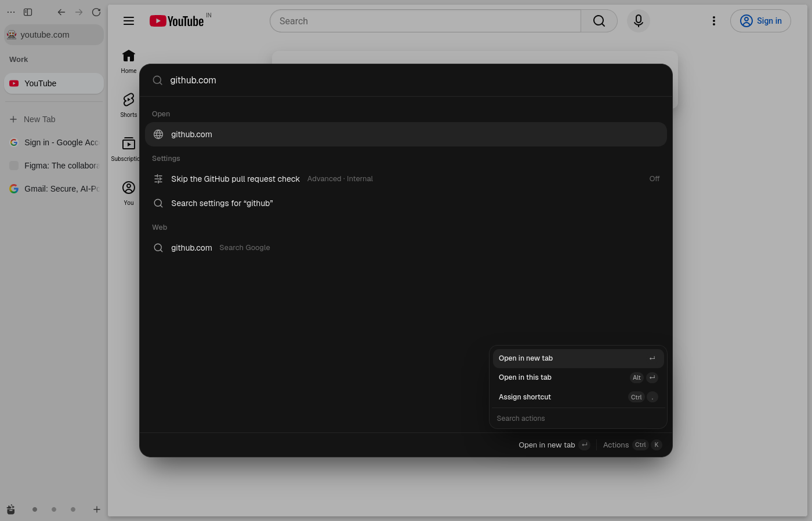
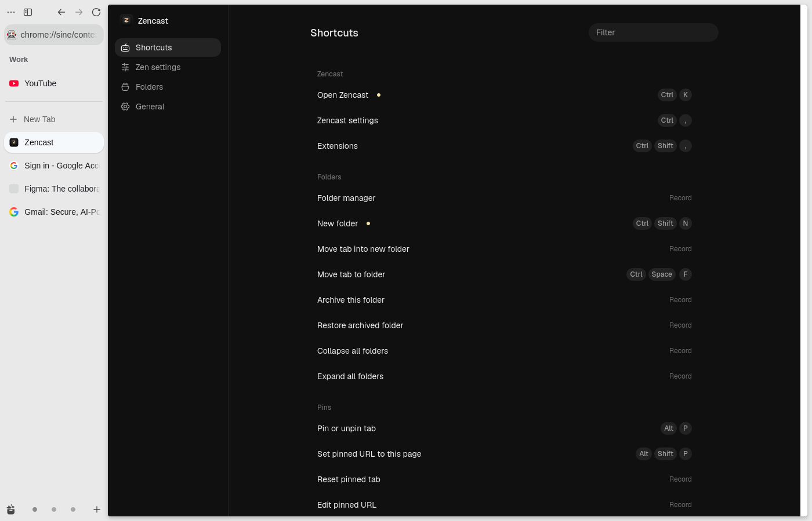
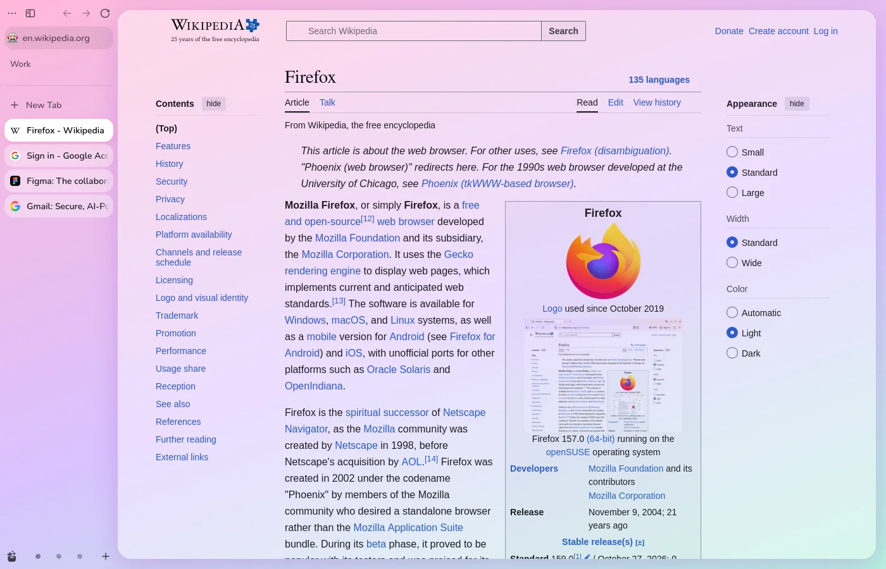
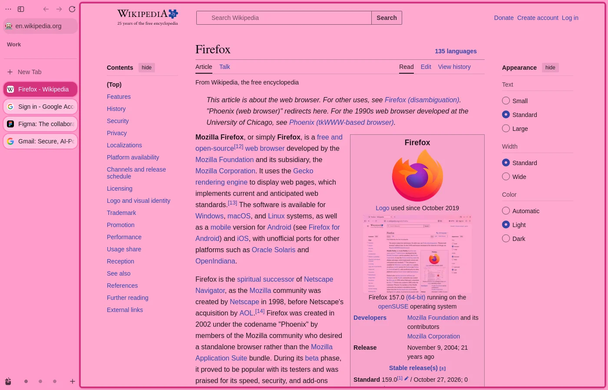
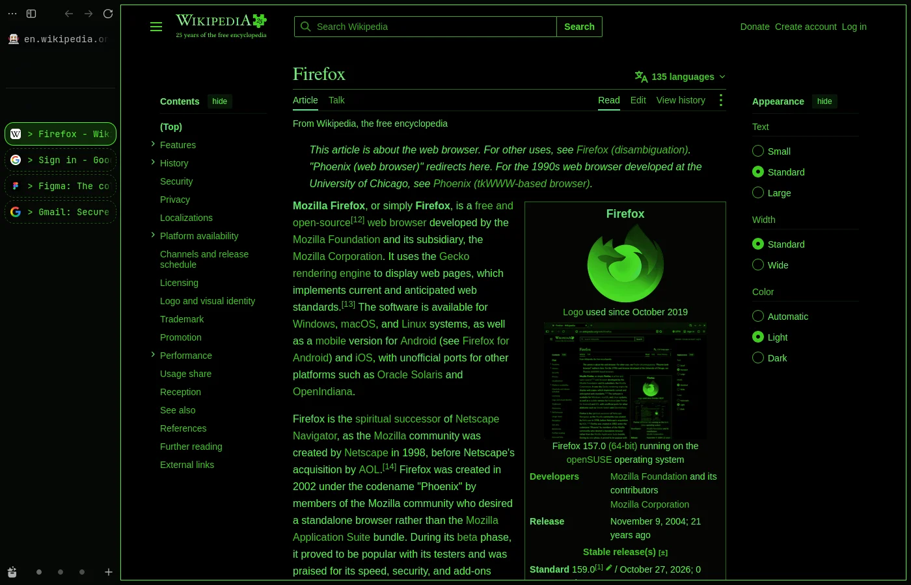
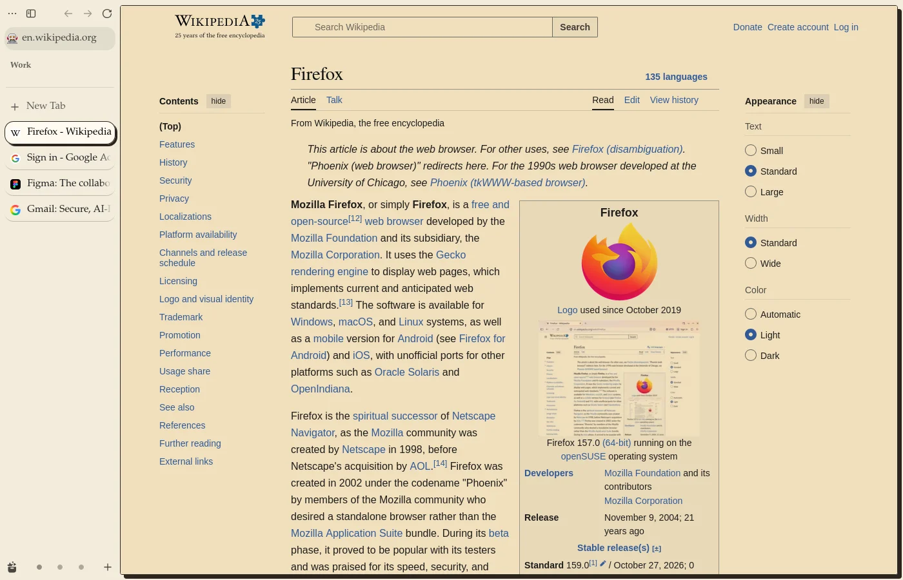

<p align="center">
  
</p>

<h1 align="center">Zencast</h1>

<p align="center">
  <b>Describe the browser you want. Your agent builds it.</b>
</p>

<p align="center">
  A one-shot template for reshaping any Firefox-based browser with your coding agent, and my own setup for Zen: Raycast for Zen, a keyboard-first palette for tabs, spaces, containers, settings and my own keys.
</p>

<p align="center">
  <a href="https://zencast.allpyq.in">Website</a> · <a href="#install">Install</a> · <a href="#features">Features</a> · <a href="#keys">Keys</a> · <a href="#make-it-yours">Make it yours</a> · <a href="#how-do-you-make-a-browser-malleable">Why Firefox</a>
</p>



## Install

One command finds your Zen profile, installs [Sine](https://github.com/CosmoCreeper/Sine) if it is missing, installs Zencast and walks you through the rest.

**Linux and macOS**

```bash
curl -fsSL https://raw.githubusercontent.com/Noelithub77/zencast/master/scripts/install/install.sh | bash
```

**Windows** (PowerShell)

```powershell
irm https://raw.githubusercontent.com/Noelithub77/zencast/master/scripts/install/install.ps1 | iex
```

Start Zen and press `Ctrl+K`. Updates arrive through Sine whenever Zen restarts.

> [!IMPORTANT]
> Zencast is not in the Sine store yet. Sine runs scripts from outside its store only when **Allow unsafe JS** is on, so setup asks to turn it on. That lets any mod you install from a link run with full browser access: install only mods you trust. Zencast is open source; every line it runs is in this repository.

<details>
<summary>Install by hand through Sine</summary>

1. Install Sine from its [releases](https://github.com/CosmoCreeper/Sine/releases/latest) and restart Zen.
2. In Zen settings › Sine, turn on "Enable installing JS from unofficial sources".
3. Paste `https://github.com/Noelithub77/zencast/tree/release` into Sine's install field.
4. Restart Zen.

</details>

## Features

**Everything is one search away.** Every tab in every space and folder, including pinned, essential and sleeping ones, plus history, bookmarks, folders, commands and every Zen setting. Loaded and recent tabs rank first; typos are forgiven.

**Open anywhere.** In the palette, `Alt+1…9` aims results at a space and `Ctrl+1…9` at a container. The palette takes that space's colour and name, and `Enter` on an open tab moves it there. Press the key again to clear.


**Hold to reveal.** Hold `Ctrl` or `Alt` and each visible result underlines a letter in its title and shows it at the row's end, both in the same pastel colour; the same key plus the letter runs it. A strip lists every other key that modifier takes in the palette, and numbers the containers (`Ctrl`) or spaces (`Alt`), so nothing has to be learned first.



**Key sheet.** Hold `Ctrl+Shift` for a moment, anywhere in Zen, to see every Zencast key at once, grouped like the palette. Let go to hide it.

**Sessions.** Every run of Zen is saved as a session, named by when it started ("Today 09:12", "Yesterday 22:40"), with each window kept apart. `Alt+S` lists them; pick one tab or a whole window back into this window. Sessions older than a week are removed. Settings has a Sessions page too.

**Settings in place.** Type a setting's name: switches flip right in the list, and numbers or text open a prompt.



**Bookmarks from the keyboard.** `Ctrl+B` bookmarks the tab in the palette: name, folder, then an optional keyword, with `Esc` stepping back. On a page already bookmarked it opens the same fields to edit, plus its key and Remove. Every bookmark is searchable by title, folder or keyword.

**Quick links.** A bookmark's keyword is its quick link: `gh zencast` searches GitHub when the bookmark's URL has `%s`, `gh` alone asks for the query, and a keyword without `%s` opens its page. They are Firefox's own bookmark keywords, so Zen's address bar knows them too. "Add starter quick links" adds `gh`, `yt`, `wiki`, `mdn`, `npm`, `maps`, `gpt`, `claude` and `cf`, keeping any keyword you already use.

**Ask ChatGPT or Claude.** Under the web search row, any query can open in ChatGPT or Claude with it already in the prompt.

**Your own shortcuts.** `Ctrl+.` records a shortcut for any command, or gives a tab, folder or site its own key. Shortcuts can be chords, like `Ctrl+Space` then `F`.

**Containers and privacy.** Open or reopen a tab in a container, start a throwaway container that deletes its data on close, move a signed-in session to another container, or wipe a site's data and history from a tab.

**Mod overlap.** Lists the Sine mods you have on that claim one of Zencast's keys or do a job the palette already does, each with a way to turn it off.

**Google account containers.** Zencast finds the Google accounts you're signed in to and gives each one its own container, named after its email. You sign in once in each, with the email already filled in. Signing in to another account offers a container for it. Only the list of emails is kept, never your cookies.

**Fast.** Measured in headless Zen with 300 tabs, at the 95th percentile:

| Open | Search | Keystroke |
| --- | --- | --- |
| 24 ms | 3.4 ms | 11 ms |

<p>
  
  
</p>

## Keys

| Key | Action |
| --- | --- |
| `Ctrl+K` | Open the palette |
| `Ctrl+,` | Zen settings |
| `Ctrl+Shift+,` | Zencast settings |
| `Ctrl+B` | Bookmark the tab, or edit its bookmark |
| `Ctrl+1…9` | Switch to space 1…9 |
| `Ctrl+Shift+1…9` | Move the tab to space 1…9 |
| `Alt+P` | Pin or unpin the tab; `Alt+Shift+P` sets its pinned URL to the current page |
| `Ctrl+Shift+N` | New folder, or a subfolder of the current tab's folder |
| `Ctrl+C` | Open in a container, when nothing is selected to copy |
| `Alt+Shift+C` | Reopen the tab in a container |
| `Alt+Shift+T` | New tab in a throwaway container |
| `Alt+M` | Move the tab's session to another container |
| `Alt+Shift+W` | Wipe the site's data and history |
| `Alt+S` | Past sessions |
| `Ctrl+Space` then `E`, `F`, `W` | Toggle essential, move to a folder, move to a space |

In the palette:

| Key | Action |
| --- | --- |
| `Enter`, `Ctrl+Enter` | Run the result's first or second action |
| `Ctrl+J` | All actions for the result |
| `Ctrl+K` | Close; whichever key opened the palette closes it |
| Hold `Ctrl` or `Alt` | Letter hints on results and a list of that modifier's keys; numbers on containers or spaces |
| `Alt+1…9`, `Ctrl+1…9` | Open results in that space or container |
| `Ctrl+.` | Record a shortcut, or assign a key to a tab, folder or site |
| `Tab`, `→` | Accept the inline completion |
| `Esc` | Back, then close |

Typing the start of a site completes it inline and takes `Enter`. A site you visited in the last few minutes completes from the DNS cache, even over a command with the same start (`allpyq` becomes `allpyq.in`); any other site completes from your history, as in Zen's address bar.

## Make it yours

These defaults are my own setup, built around how I use Zen, and some of them replace Zen's keys:

| Key | Zen's own action, replaced |
| --- | --- |
| `Ctrl+1…9` | Select tab 1…9 on Windows (Zencast switches space, only while that space exists) |
| `Ctrl+K` | Focus web search |
| `Ctrl+Shift+N` | New unsynced window |
| `Ctrl+C` | Copy, only when nothing is selected |

Change any of them in settings (`Ctrl+Shift+,`, or the gear on Zencast's card in Sine).



### Make it look like anything

A look is one CSS file for Zen's own window. These four are real Zen, restyled by the files in [`src/looks/`](src/looks) and captured by `pnpm ops look`:

<p>
  
  
  
  
</p>

Ask your agent for a look; the `restyle` skill has it write the CSS, preview it headless and ship it.

### Fork it

Zencast is a template for customising Zen, or any Firefox, from the inside. A Sine mod runs with full browser access, so anything the browser's own UI can do, a fork can do. Fork the repository and point your agent at it; everything it needs to start is here:

| | |
| --- | --- |
| [`AGENTS.md`](AGENTS.md) | Map of the code and its conventions |
| [`.claude/skills/`](.claude/skills) | Add a command, restyle Zen, find Zen and Firefox internals, ship a release |
| `pnpm ops` | Build, install into a profile, probe a live Zen with `eval`, preview looks, run e2e and benchmarks headless |
| [`scripts/install/`](scripts/install) | The one-line setup, ready to point at your fork |
| [`docs/distribution.md`](docs/distribution.md) | How the mod ships and updates through Sine |

```bash
pnpm install
```

```bash
pnpm ops --help
```

## How do you make a browser malleable?

Malleable software is "a software ecosystem where anyone can adapt their tools to their needs with minimal friction".[^malleable] The browser is where most of us work all day, and it is one of the hardest tools to change. There are four ways in:

| Route | How deep it goes | What a change costs | Security updates |
| --- | --- | --- | --- |
| Chrome extension | Web pages and a sandboxed API | Reload the extension | Chrome's own |
| Vivaldi JS mods | Vivaldi's HTML interface | Copy the scripts back after every update[^vivaldi] | Vivaldi's own |
| Fork Chromium | Everything | Rebuild the browser | Only as fast as you rebase |
| **Firefox with a script loader** | **Everything the browser's own interface can do** | **Edit and restart; CSS applies live** | **Firefox's or Zen's own** |

**Extensions stop at the sandbox.** Chrome's toolbar, tab strip and dialogs are native C++ views,[^views] not a page a script can reach. An extension gets the tabs, history and a small part of settings; it cannot change the interface, it may suggest at most four shortcuts, and some Chrome shortcuts "always take priority" over it.[^commands] Spaces, folders and containers do not exist there to script.

**Forking Chromium means owning a browser.** The source alone needs at least 100 GB of disk and half an hour to download on a fast connection,[^chromium-build] every change means a rebuild, and nothing loads live. Chrome now ships a major version every two weeks with security fixes weekly in between,[^cadence] and a fork is exposed for as long as it trails: attackers already exploit the gap between a fix landing in Chromium and browsers shipping it.[^patch-gap] Vivaldi is the closest Chromium gets to modding, and its JS mods are wiped by every update.[^vivaldi]

**Firefox still lets you in.** Its interface is built from markup, CSS and JavaScript, like a web page. Firefox 57 retired the old add-ons that could change it,[^ff57] but a script loader in the install folder still runs your files "in Firefox browser context", with the same reach as the browser's own code.[^fx-autoconfig] The browser updates as usual underneath, so security fixes arrive on the vendor's schedule, and your mod is a few files in your profile.

**Zen is the best starting point.** It is Firefox with spaces, folders, essentials, split view and compact mode already built, and a community that mods it daily: its interface can be restyled live from the Browser Toolbox,[^zen-live] and [Sine](https://github.com/CosmoCreeper/Sine) adds the script loader with installs and updates from a link. Zencast builds on all of it, and as of October 2026 no other setup gets this deep at this cost.

[^malleable]: Geoffrey Litt, Josh Horowitz, Peter van Hardenberg and Todd Matthews, [Malleable software: Restoring user agency in a world of locked-down apps](https://www.inkandswitch.com/essay/malleable-software/), Ink & Switch, June 2025.
[^views]: Chromium, [Browser Views](https://chromium.googlesource.com/chromium/src.git/+/main/chrome/browser/ui/views/README.md): the browser window, tabs and dialogs are implemented in Views, Chromium's C++ UI toolkit.
[^commands]: Chrome for Developers, [chrome.commands](https://developer.chrome.com/docs/extensions/reference/api/commands).
[^chromium-build]: Chromium, [Checking out and building Chromium on Linux](https://chromium.googlesource.com/chromium/src/+/main/docs/linux/build_instructions.md): at least 100 GB of free disk and 8 GB of RAM, with more than 16 GB "highly recommended"; the checkout alone takes "30 minutes on even a fast connection".
[^cadence]: Chrome for Developers, [Fresher features, faster fixes: the two-week release cycle is here](https://developer.chrome.com/blog/chrome-two-week-start), September 2026.
[^patch-gap]: CSO Online, [Attackers are weaponizing the gap between Chromium fixes and Chrome patches](https://www.csoonline.com/article/4220939/attackers-are-weaponizing-the-gap-between-chromium-fixes-and-chrome-patches.html), September 2026.
[^vivaldi]: Vivaldi forum, [Modding Vivaldi](https://forum.vivaldi.net/topic/10549/modding-vivaldi): "Functional changes (JS files) however will get wiped after each update".
[^ff57]: Mozilla Add-ons Blog, [The road to Firefox 57: compatibility milestones](https://blog.mozilla.org/addons/2017/02/16/the-road-to-firefox-57-compatibility-milestones/), February 2017.
[^fx-autoconfig]: MrOtherGuy, [fx-autoconfig](https://github.com/MrOtherGuy/fx-autoconfig), a minimal loader using Firefox's AutoConfig. Sine installs a loader the same way.
[^zen-live]: Zen docs, [Live editing Zen theme](https://docs.zen-browser.app/guides/live-editing).
