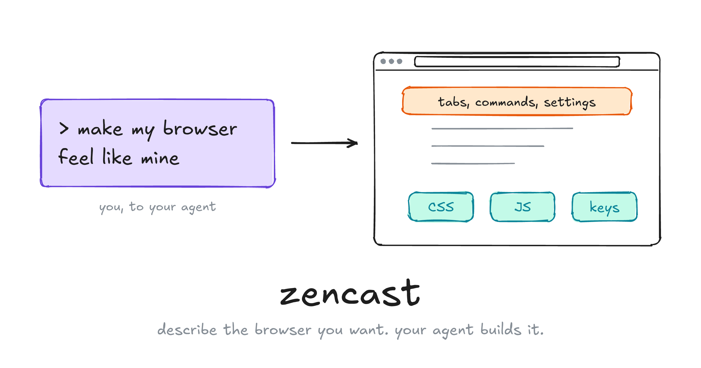
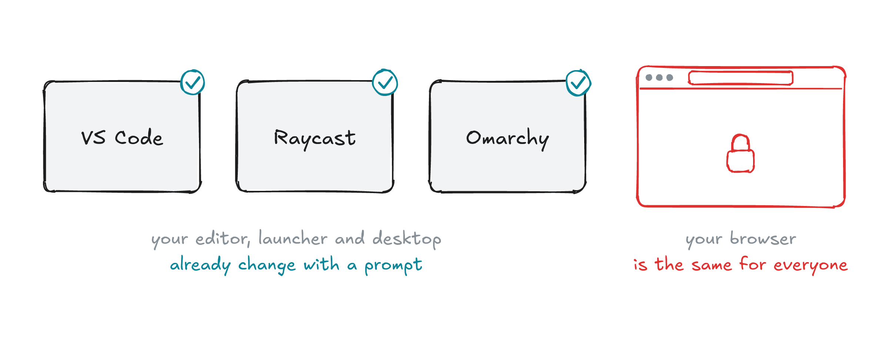
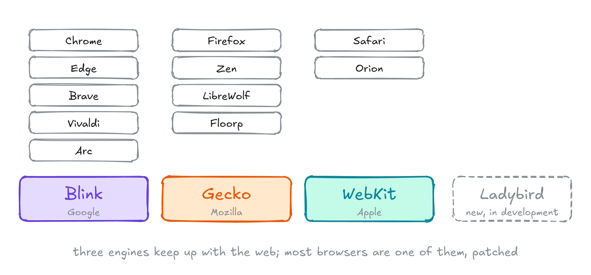
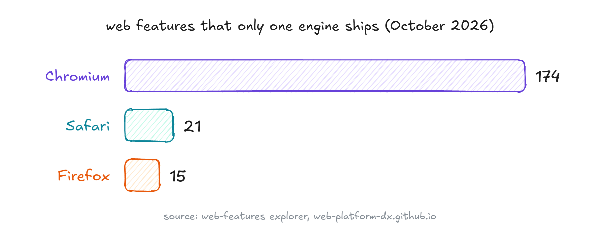
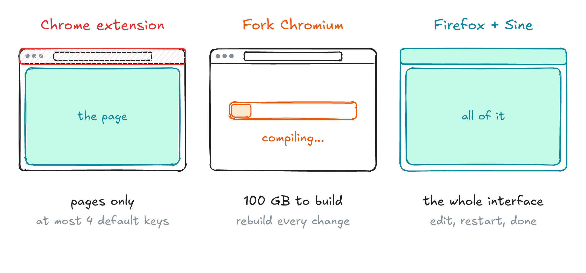
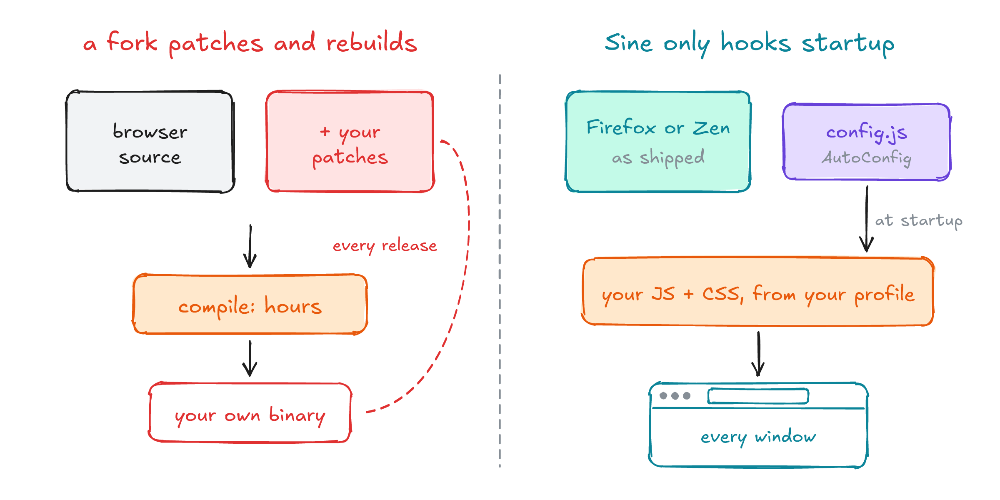
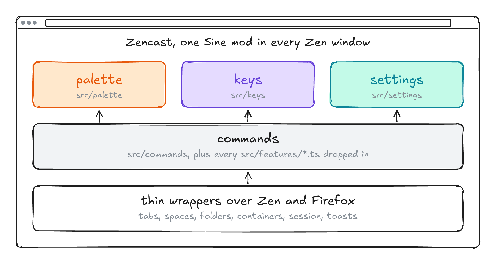
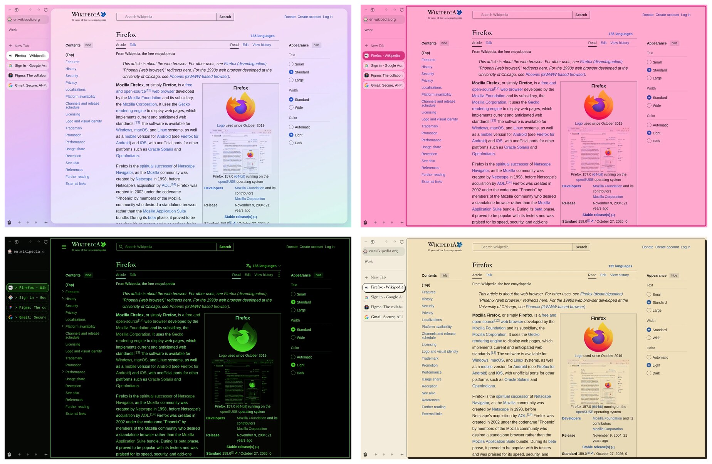
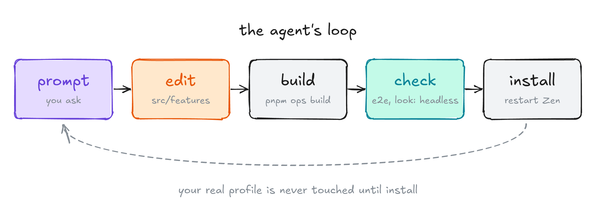

# My Browser Should Bend Too

*How I made Zen something my coding agent can reshape with a prompt, without forking a browser*



## 1. Why Zencast?

Most of my day goes through two boxes. In VS Code I press `Ctrl+Shift+P` and type what I want instead of hunting through menus. On the desktop, Raycast does the same for everything else. And on Omarchy, my whole desktop is plain config files, so when I want a new key or a different bar, I ask my coding agent and it's done.

Then I open the browser, the place where most of that day actually happens, and nothing bends. Forrester found people spend about 2.7 hours of their workday in the browser [1]. Every one of those hours runs through an interface that is the same for everyone.


*My editor, launcher and desktop are mine. My browser isn't.*

Ink & Switch call the opposite of this *malleable software*: an ecosystem where anyone can adapt their tools to their needs with minimal friction [2]. Coding agents make that friction tiny for almost everything. I wanted the same for my browser.

## 2. Why not just build a browser?

Because almost nobody can. Three engines keep up with the web: Blink (Chromium), Gecko (Firefox) and WebKit (Safari) [3]. Nearly every browser you have heard of is one of them with changes on top. Ladybird is the one serious attempt at a new engine, written from scratch, and it is still in development [4].


*Three engines. Everything else is built on one of them.*

New web features usually reach Chromium first. Today the web-features explorer lists 174 features that only Chromium ships, against 21 only in Safari and 15 only in Firefox [5]. Firefox isn't always last (it had subgrid first), but keeping up with standards is a full-time job for large teams.


*Keeping up with the web is the real cost of a browser.*

Even building one is heavy. Chromium asks for at least 100 GB of disk and more than 16 GB of RAM, and the checkout alone takes about half an hour on a fast connection [6]. Firefox asks for 30 GB [7]. Then Chrome ships a new version every two weeks [8], and attackers already exploit the gap between a fix landing in Chromium and a browser shipping it [9].

So I didn't want a new browser. I wanted my own layer on a good one.

## 3. Three ways in


*How deep each route goes, and what it costs.*

**Chrome extensions** stop at a sandbox. Chrome's tabs, toolbar and dialogs are native C++ views [10], not something a script can touch. An extension can suggest at most four keyboard shortcuts [11], and spaces, folders and containers don't exist there to script.

**Forking Chromium** means owning a browser: the 100 GB build, a rebuild for every change, and every security release to keep up with. Vivaldi is the closest Chromium gets to modding, and its JS mods are wiped by every update [12].

**Firefox** is different. Its interface is built from markup, CSS and JavaScript, much like a web page. Firefox 57 retired the old add-ons that could change it [13], but one door stayed open: AutoConfig.

## 4. Sine never patches

Most projects built on another browser patch its source and compile their own binary. Zen itself does this: its repository carries 272 `.patch` files against Firefox [14]. That's the right call for a browser, and a terrible one for a personal tweak.

[Sine](https://github.com/CosmoCreeper/Sine) takes the other path. Firefox runs a config file from its install folder at startup, with full privileges. Sine puts a small loader there, the same way fx-autoconfig does [15], and that loader reads the mods in your profile and runs each one's JavaScript and CSS in every browser window.


*Nothing is compiled. The browser stays exactly as shipped.*

That has two nice consequences. The browser updates as usual underneath, so security fixes arrive on Mozilla's and Zen's schedule, not mine. And a mod is just a few files in a folder, which is exactly the kind of thing an agent is good at writing.

I picked Zen as the base because it already has spaces, folders, essentials, split view and compact mode, and a community that mods it every day.

## 5. What Zencast is

Zencast is my own setup: a keyboard-first command palette for Zen, a little like Raycast for the browser. `Ctrl+K` searches every tab in every space and folder, history, bookmarks, commands and every Zen setting.


*One box for tabs, commands, settings and sites.*

A few things I use all the time:

- **Open anywhere.** In the palette, `Alt+2` aims the result at my second space and `Ctrl+1` at a container.
- **Hold to reveal.** Holding `Ctrl` puts a letter on every result; `Ctrl+letter` runs it.
- **Settings in place.** Typing a setting's name lets me flip it right in the list.
- **My own keys.** `Ctrl+.` records a shortcut for any command, including chords like `Ctrl+Space` then `F`.

Under the hood it's one Sine mod. The palette is React in a shadow root, search is uFuzzy, and every command sits on thin wrappers over Zen's tabs, workspaces, folders and containers.


*One mod, loaded into every Zen window.*

Performance was a constraint from the start. In a headless Zen with 300 tabs, opening the palette takes 24 ms at the 95th percentile, a search 3.4 ms and a keystroke 11 ms.

## 6. Make it look like anything

A browser you can reshape isn't only about commands. A look is one CSS file for Zen's own window, and the same window can become any of these:


*Candy, pink, terminal and paper: the same Zen, one stylesheet each.*

Getting there taught me a few things about Zen's internals. Zen sets its window colour inline on `#browser`, so overriding its variable does nothing; you paint the background layers directly. And hue filters can't tint a white page, but a `mix-blend-mode: multiply` layer over the page can.

None of that has to be remembered by me. The repo's `restyle` skill tells the agent which selectors to use, and `pnpm ops look` screenshots each stylesheet in an isolated headless Zen, so the agent can check its own work before I ever restart my browser.

## 7. A template for your agent

This is the part I care about most. Zencast is my setup, but the repository is built to be forked and handed to an agent.

A new feature is one file. Anything in `src/features/` that exports commands joins the palette, and any CSS there is applied to every window. Here's the one feature the repo ships, trimmed a little:

```ts
export const commands: Command[] = [{
  id: "tab.copyMarkdownLink",
  title: "Copy as Markdown link",
  section: "Tabs",
  run: async ({ win, tab, ui }) => {
    const url = tab.linkedBrowser?.currentURI?.spec ?? ""
    await win.navigator.clipboard.writeText(`[${tab.label}](${url})`)
    ui.toast("Copied as Markdown")
  },
}]
```

That command came from a one-line prompt. Around it, the repo gives the agent what it needs to work on its own: an `AGENTS.md` that maps the code, skills for adding commands, restyling Zen and finding browser internals, and a `pnpm ops` command that builds, runs end-to-end checks and benchmarks in an isolated headless Zen, and installs into a profile.


*The agent's loop. My real profile is only touched at the end.*

## 8. Trust

There's a catch, and it's a big one. Code running in your browser's interface can see every session you have. In December 2024 a hijacked Chrome extension update exposed people's cookies and sessions [16]. A Sine mod has even more reach than an extension.

That's why Sine only runs scripts from outside its store when you turn on "Allow unsafe JS", and why I think of Zencast as a template rather than a product. Read what you install. Better yet, have your agent build your own and read that.

## What I want to explore next

Getting Zencast into the Sine store, so it installs without the unsafe JS switch. More looks, and more feature modules that people can copy between forks. And I want to see how far "describe the browser you want" really goes.

If you've ever wished your browser worked the way you do, fork it and ask your agent for something. Then tell me what you built.

**Source code:** [github.com/Noelithub77/zencast](https://github.com/Noelithub77/zencast) · **Website:** [zencast.allpyq.in](https://zencast.allpyq.in)

## Sources

1. [Forrester for Google, the rising importance of the browser (2018)](https://services.google.com/fh/files/helpcenter/the_rising_impotance_of_browser_in_enterprise_it_strategies_infographic.pdf)
2. [Ink & Switch, Malleable software (2025)](https://www.inkandswitch.com/essay/malleable-software/)
3. [Wikipedia, comparison of browser engines](https://en.wikipedia.org/wiki/Comparison_of_browser_engines)
4. [W3C, Ladybird: a new browser engine](https://www.w3.org/events/meetings/8e1ca708-fdbf-4264-a79b-4c953fa85248)
5. [web-features explorer, features only in Chromium](https://web-platform-dx.github.io/web-features-explorer/only-in/chromium/), [Safari](https://web-platform-dx.github.io/web-features-explorer/only-in/safari/) and [Firefox](https://web-platform-dx.github.io/web-features-explorer/only-in/firefox/), October 2026
6. [Chromium, checking out and building on Linux](https://chromium.googlesource.com/chromium/src/+/main/docs/linux/build_instructions.md)
7. [Firefox, building on Linux](https://firefox-source-docs.mozilla.org/setup/linux_build.html)
8. [Chrome for Developers, the two-week release cycle (2026)](https://developer.chrome.com/blog/chrome-two-week-start)
9. [CSO Online, the gap between Chromium fixes and Chrome patches (2026)](https://www.csoonline.com/article/4220939/attackers-are-weaponizing-the-gap-between-chromium-fixes-and-chrome-patches.html)
10. [Chromium, Browser Views](https://chromium.googlesource.com/chromium/src.git/+/main/chrome/browser/ui/views/README.md)
11. [Chrome for Developers, chrome.commands](https://developer.chrome.com/docs/extensions/reference/api/commands)
12. [Vivaldi forum, Modding Vivaldi](https://forum.vivaldi.net/topic/10549/modding-vivaldi)
13. [Mozilla, the road to Firefox 57 (2017)](https://blog.mozilla.org/addons/2017/02/16/the-road-to-firefox-57-compatibility-milestones/)
14. [Zen's source, patches against Firefox](https://github.com/zen-browser/desktop/tree/dev/src)
15. [fx-autoconfig](https://github.com/MrOtherGuy/fx-autoconfig)
16. [Expel, the Christmas Day Chrome extension compromise (2024)](https://expel.com/blog/security-alert-christmas-day-chrome-extension-compromise/)

Also: [VS Code's Command Palette](https://code.visualstudio.com/docs/getstarted/userinterface#_command-palette), [Raycast](https://www.raycast.com/), [the Omarchy manual](https://learn.omacom.io/2/the-omarchy-manual) and [Zen's live editing guide](https://docs.zen-browser.app/guides/live-editing).
